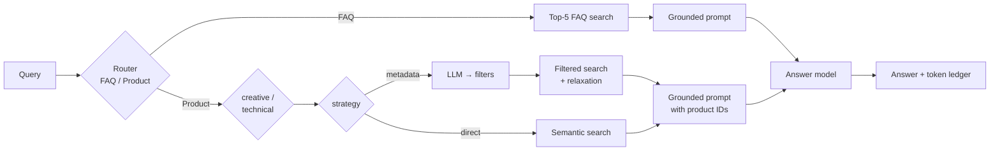

# Fashion Hub Search Bot

A retrieval-augmented (RAG) shopping assistant for a fashion store. It answers **store FAQ** questions and **finds / styles products** from a catalog, keeps token cost low, and traces every step in **Phoenix**.

It's built in two layers:

- **`rag_kit/`**: a small, domain-agnostic RAG toolkit. You can copy it into any project.
- **`fashion_hub/`**: the Fashion Hub app, built only from `rag_kit` pieces plus one domain `schema.py`.

There are also **`notes/`** (my reference notes on the ideas behind each piece) and **`.claude/skills/`** (Claude Code skills that reuse this repo).

> Built as the final project of the DeepLearning.AI *RAG* course, then rewritten as reusable code. No course code, datasets or graded solutions are included. The sample catalog in `fashion_hub/data/` is synthetic.

---

## How it answers a message



| Technique | Where | Note |
|---|---|---|
| Task classification / routing with a cheap model | `rag_kit/router.py` | [01](notes/01-task-classification-routing.md) |
| LLM params chosen by task nature | `rag_kit/params.py` | [02](notes/02-llm-params-by-task.md) |
| Short prompts: fewer examples, low `max_tokens`, `temperature=0` | `fashion_hub/schema.py` | [03](notes/03-prompt-token-optimization.md) |
| Top-k retrieved docs instead of the whole corpus | `rag_kit/context.py` | [04](notes/04-retrieve-dont-stuff.md) |
| Metadata filtering vs direct RAG for products | `rag_kit/metadata_filter.py` | [05](notes/05-metadata-filter-vs-direct-rag.md) |
| Weaviate with self-provided vectors | `rag_kit/retrieval.py` | [06](notes/06-weaviate-setup.md) |
| Phoenix / OpenTelemetry tracing | `rag_kit/tracing.py` | [07](notes/07-phoenix-tracing.md) |
| Token ledger and cost per step | `rag_kit/cost.py` | [08](notes/08-cost-and-token-accounting.md) |

**Key finding from the course:** direct RAG uses far fewer tokens, because it makes no extra LLM call. LLM-generated metadata filters return **better products**, because hard constraints like gender, colour and price are enforced exactly instead of approximated by an embedding. This repo keeps the filter path and makes it cheaper: a compact prompt, validated output, and relaxation when the filters are too strict. See [note 05](notes/05-metadata-filter-vs-direct-rag.md).

---

## Repository layout

```
fashion-hub-search-bot/
├── rag_kit/                 # ♻️ reusable: copy into any RAG project
│   ├── config.py            #   Settings from env (.env)
│   ├── llm.py               #   OpenAI-compatible client → content + token usage; FakeLLM for tests
│   ├── params.py            #   GenParams presets per task
│   ├── router.py            #   few-shot LLM classifier with label normalization
│   ├── retrieval.py         #   Weaviate connect/create/ingest/search + sentence-transformers embedder
│   ├── metadata_filter.py   #   LLM → JSON → validated Weaviate filters, relaxation
│   ├── context.py           #   compact context formatting, most-relevant-last ordering
│   ├── prompts.py           #   grounded-answer prompt builder
│   ├── tracing.py           #   OTel spans with OpenInference attributes (Phoenix-ready, no-op without it)
│   ├── cost.py              #   TokenLedger + cost estimate
│   └── pipeline.py          #   RAGApp: route → handler → answer, with chat history
├── fashion_hub/             # 👗 the app
│   ├── schema.py            #   domain config: fields, filters, routing prompts  ← rewrite this for a new domain
│   ├── bot.py               #   FashionHubBot (FAQ + product handlers, two retrieval strategies)
│   ├── factory.py           #   build real clients from Settings
│   ├── ingest.py            #   create collections + load data
│   ├── cli.py               #   terminal chat
│   └── data/                #   synthetic sample products.json + faq.json
├── scripts/compare_strategies.py   # metadata vs direct: tokens + top-5 precision
├── notes/                   # 📝 self-notes (concepts, pitfalls, references)
├── .claude/skills/          # 🤖 Claude Code skills: rag-scaffold, rag-token-optimizer, weaviate-setup, phoenix-tracing
├── tests/                   # offline tests (FakeLLM + fake store)
├── docker-compose.yml       # Weaviate + Phoenix
└── .env.example
```

---

## Quickstart

```bash
# 1. install
python -m venv .venv && source .venv/bin/activate
pip install -e ".[all,dev]"

# 2. infra (Weaviate :8080/:50051, Phoenix :6006)
docker compose up -d
#    no Docker? set WEAVIATE_MODE=embedded in .env and run Phoenix with:
#    pip install arize-phoenix && phoenix serve

# 3. configure
cp .env.example .env        # add LLM_API_KEY (Together, OpenAI, Groq, Ollama… any OpenAI-compatible API)

# 4. load data
python -m fashion_hub.ingest

# 5. chat
python -m fashion_hub.cli                     # metadata-filter strategy
python -m fashion_hub.cli --strategy direct   # direct semantic search

# 6. compare strategies, then open http://localhost:6006 to inspect traces
python scripts/compare_strategies.py
```

Example session:
```
You: Black party dress for women under $100
Bot [Product]: The H&M Women Black Velvet Cocktail Dress (ID: 10010, $89) ...
  ↳ 1712 tokens (route=92, task_nature=71, metadata=339, answer=1210)  ~$0.001

You: How do I return it?
Bot [FAQ]: Go to My Orders, choose the item and click Return ...
```
(Token numbers are illustrative. Your model and provider will change them.)

## Run the tests (no API key or Docker needed)

```bash
pytest -q
```

---

## Reusing `rag_kit` in another project

```python
from rag_kit import LLMRouter, RAGApp, PreparedCall, params_for, format_records, order_for_prompt
from rag_kit.config import Settings
from rag_kit.llm import OpenAICompatibleLLM
from rag_kit.prompts import grounded_answer_prompt
from rag_kit.retrieval import Embedder, WeaviateStore, connect
from rag_kit.tracing import setup_phoenix

s = Settings.from_env()
setup_phoenix(s.phoenix_project, s.phoenix_endpoint)
llm = OpenAICompatibleLLM(s.llm_base_url, s.llm_api_key, s.router_model, s.llm_extra_body)
docs_store = WeaviateStore(connect(s), "Docs", Embedder(s.embed_model), text_fn=lambda r: r["text"])

def handle_docs(query, ledger):
    hits = docs_store.search(query, limit=5)
    ctx = format_records(order_for_prompt(hits), {"Doc": "text"})
    return PreparedCall(grounded_answer_prompt(query, ctx, role="You are a helpful support agent."),
                        params_for("technical"), sources=hits)

app = RAGApp(
    llm,
    router=LLMRouter(llm, ["docs", "chitchat"], "Classify as docs (needs documentation) or chitchat. One word."),
    handlers={"docs": handle_docs},
    fallback=lambda q, l: PreparedCall(q, params_for("default")),
    answer_model=s.answer_model,
)
print(app.answer("How do I reset my password?").content)
```

Full checklist: [notes/09-build-any-rag-checklist.md](notes/09-build-any-rag-checklist.md).
Claude Code users: the `rag-scaffold` skill does this for you. Copy `.claude/skills/*` to `~/.claude/skills/` to use the skills in any project.

## License
MIT
