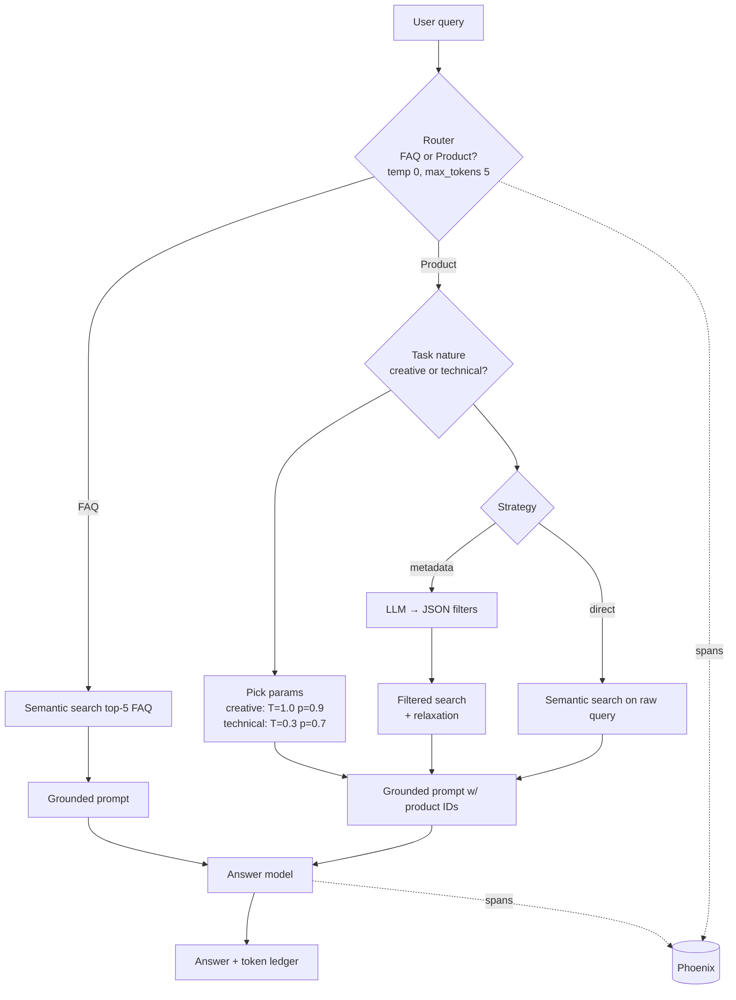

# RAG Notes — index

Personal reference notes from the RAG course final project (Fashion Hub bot).
Each note has: **the idea → why → how (code in `rag_kit`) → pitfalls**.

| # | Note | One-line takeaway |
|---|------|-------------------|
| 01 | [Task classification & routing](01-task-classification-routing.md) | Use a cheap LLM call to decide *which pipeline* runs before spending tokens on retrieval/answers. |
| 02 | [LLM parameters by task](02-llm-params-by-task.md) | Temperature/top_p/max_tokens follow the task: 0/tiny for labels, high for creative. |
| 03 | [Prompt token optimization](03-prompt-token-optimization.md) | Define labels instead of listing examples; keep only the hard examples; cap output. |
| 04 | [Retrieve, don't stuff](04-retrieve-dont-stuff.md) | Put top-k retrieved docs in context, not the whole corpus (≈1220 → <500 tokens). |
| 05 | [Metadata filter vs direct RAG](05-metadata-filter-vs-direct-rag.md) | Direct search is cheaper; LLM-generated filters give better results on hard constraints. |
| 06 | [Weaviate setup](06-weaviate-setup.md) | Docker / embedded / cloud; self-provided vectors; FIELD tokenization for filter fields. |
| 07 | [Phoenix tracing](07-phoenix-tracing.md) | Trace every step with OpenInference span kinds and token counts to see where cost comes from. |
| 08 | [Cost & token accounting](08-cost-and-token-accounting.md) | Cost of a query = sum of *all* LLM calls; track per step. |
| 09 | [Checklist: build any RAG](09-build-any-rag-checklist.md) | Step-by-step recipe to reuse `rag_kit` in a new domain. |
| — | [References](references.md) | Docs, papers and further reading. |

## The whole course in one diagram

